
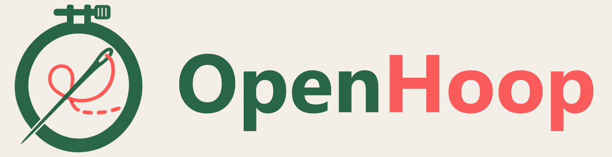

<b>Free, open-source organizer for machine embroidery designs.</b> 
Tidy up years of downloads, find any design in seconds, and send it to your machine in the right format. 
<i>English · Italiano · Français · Español</i>

<a href="https://ko-fi.com/openhoop">☕ Support OpenHoop on Ko-fi</a>

---

> **🧪 Early stage — testers wanted!**
> OpenHoop is brand new. So far it has been tested on stitch-outs with **one Brother machine (PES files)** only.
> Janome, Bernina, Husqvarna Viking, Pfaff, Singer and other machines are supported on paper, but nobody has tried
> them yet. If you own one, please tell us how it went — whether the files open, the hoop, the colours, the stitch
> quality and the patches — by opening an [issue](../../issues) (photos welcome!).
> Always test on a scrap of fabric first.

## Why OpenHoop?

Over the years I collected **hundreds of thousands of embroidery files**: bundles, freebies, purchases, the same design
in five formats and three sizes, zips inside zips. Finding «that cat in 130×180» meant an evening of digging.
The programs that could help are expensive, made for professionals, and still don't really organize a collection.

So I built the tool I wanted for my own machine, and I'm giving it away: hobby embroiderers deserve good tools without
paying hundreds for a licence. OpenHoop is made by a hobby embroiderer **with the help of AI coding tools**. It's free,
open source and tested on real stitch-outs: if something doesn't work on your machine, please open an issue.

## What it does

- **Tidies up your designs**: reads all your folders (and the zips inside), keeps **one file per design** even when you
  have it in PES, DST, JEF, VP3…, removes duplicates and sorts everything by theme with thumbnails.
  **Your original files are never moved, changed or deleted.**
- **Finds designs**: by name, by size («130x180») or **by meaning** («sleeping cat», «red roses»); similar designs,
  all sizes of the same design together, «fits my hoops» filter.
- **Design card**: real size, colours, stitches, stitching time, jumps and how many threads you will trim by hand,
  thread list matched to your thread brand, shopping list of missing spools.
  **Try other colours right on the design**: move the mouse over it, the part under the mouse lights up, click to
  pick another thread — the preview changes at once and you can save it as a colour version of the design.
- **Exports for your machine**: Brother/Baby Lock (PES), Janome/Elna (JEF), Husqvarna Viking/Pfaff (VP3),
  Bernina (EXP), Singer (XXX), Tajima/others (DST) — straight to the USB stick, with rotate, mirror,
  **smart resize** (stitches recalculated, not just stretched) and a printable sheet.
- **Patch maker**: turn any design into a patch — circle, oval, shield, heart, hexagon or outline shape, satin border
  in your thread colours, on felt/twill or fully stitched. The design's stitched background is removed
  automatically, and the patch is saved next to the original design in your library.
- **Compositions** of several designs with **lettering** in 140 embroidery fonts.
- **Digitizer** for simple flat-colour images, with stitch-by-stitch simulation; **find free designs** online
  (translated search, licences shown).
- **Import** new downloads: files, zips, folders, links and xTool/Atomm `.xs` projects; duplicates are detected
  (also between files of the same download), shown side by side, and the file in your machine's format is kept.
  PDF instructions and colour charts stay next to the design.
- **Fix your library** without starting over: attach the instructions left in the original folders, give clear names,
  move «misc» designs to the right theme by looking at the picture, remove duplicates — preview first, undo anytime.
- Favourites, collections, «already stitched» journal with photos.

Everything runs **on your computer**: no account, no cloud, no subscription.
From version 1.0.1 OpenHoop tells you when a new version is out and **updates itself with one click**
(Settings → Updates): your designs and settings are not touched, and you can go back to the previous version.

## Screenshots

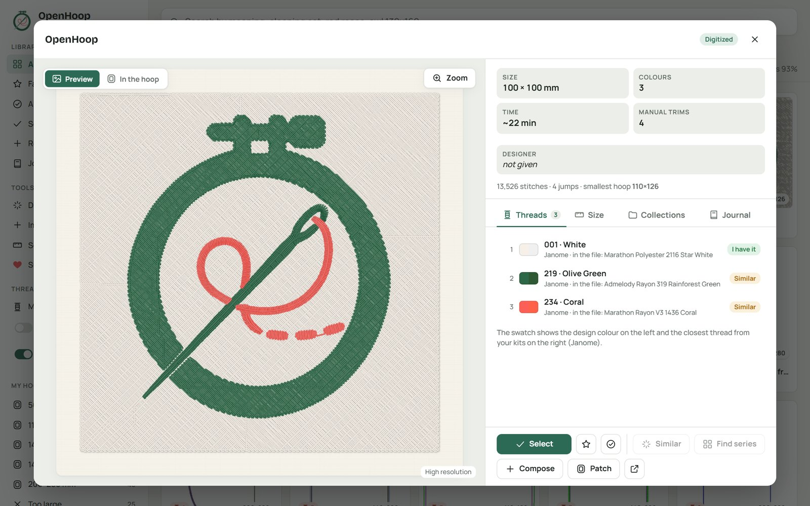

| Patch maker | Digitizer |
| --- | --- |
| 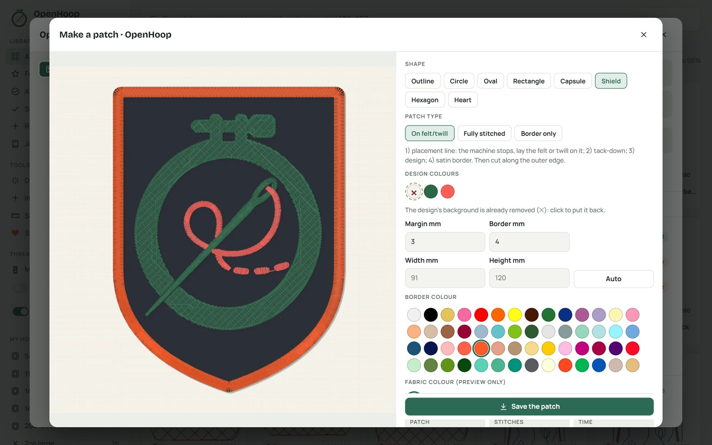 | 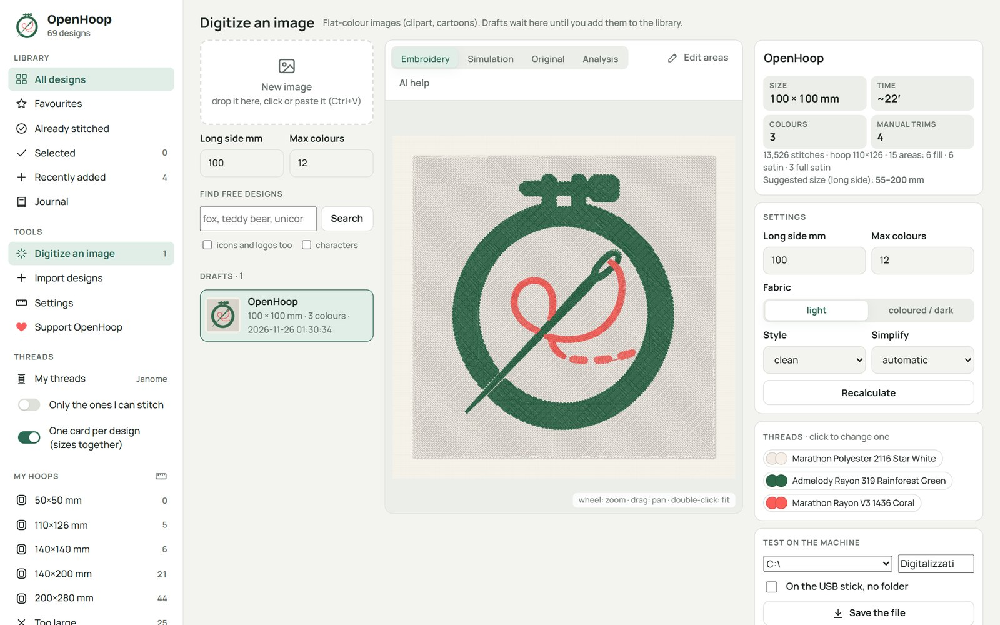 |
| **Stitch-by-stitch simulation** | **Settings: folders, machine, hoops** |
| 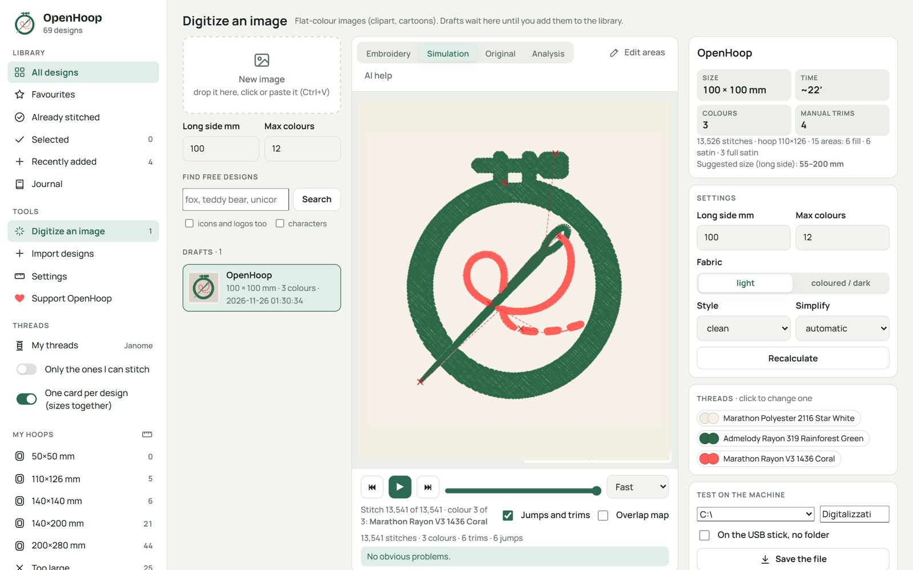 | 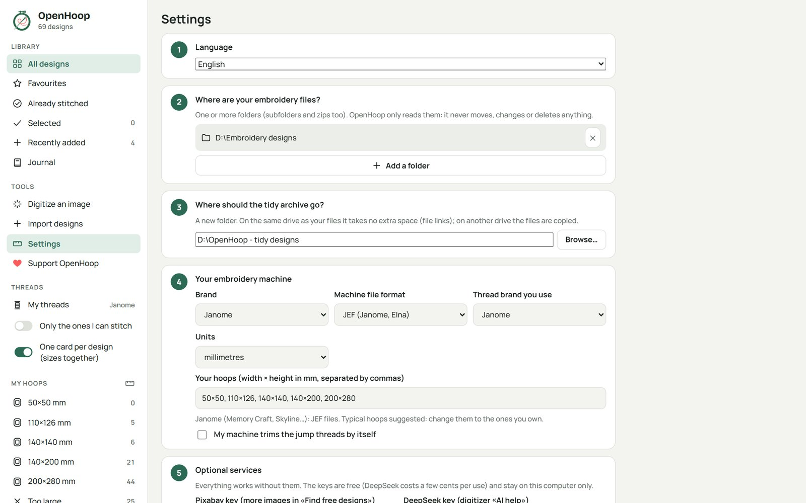 |
| **Your library, sorted by theme** | **Import: filters, attachments, duplicates flagged** |
| 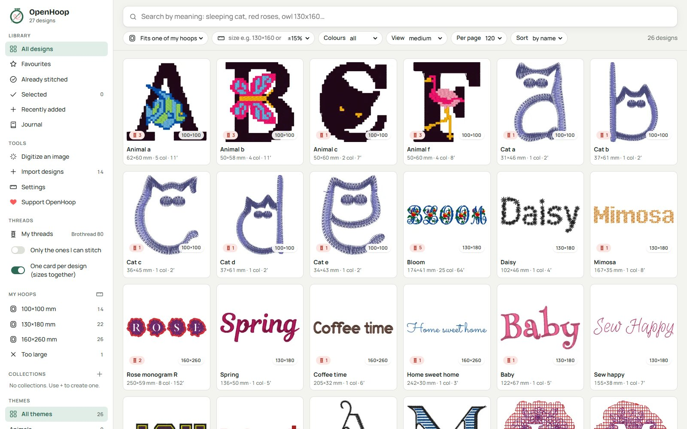 | 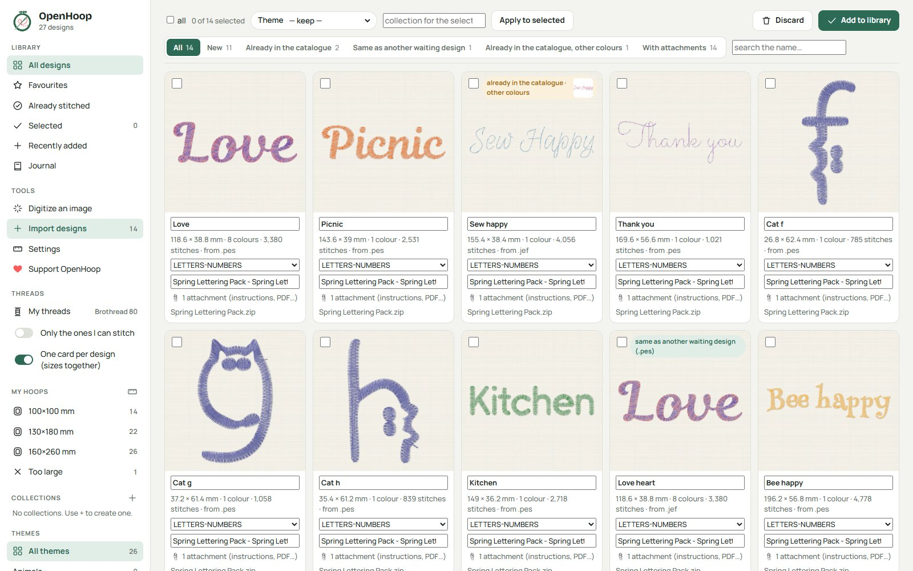 |
| **Duplicates side by side** | **Colour versions of the same design** |
| 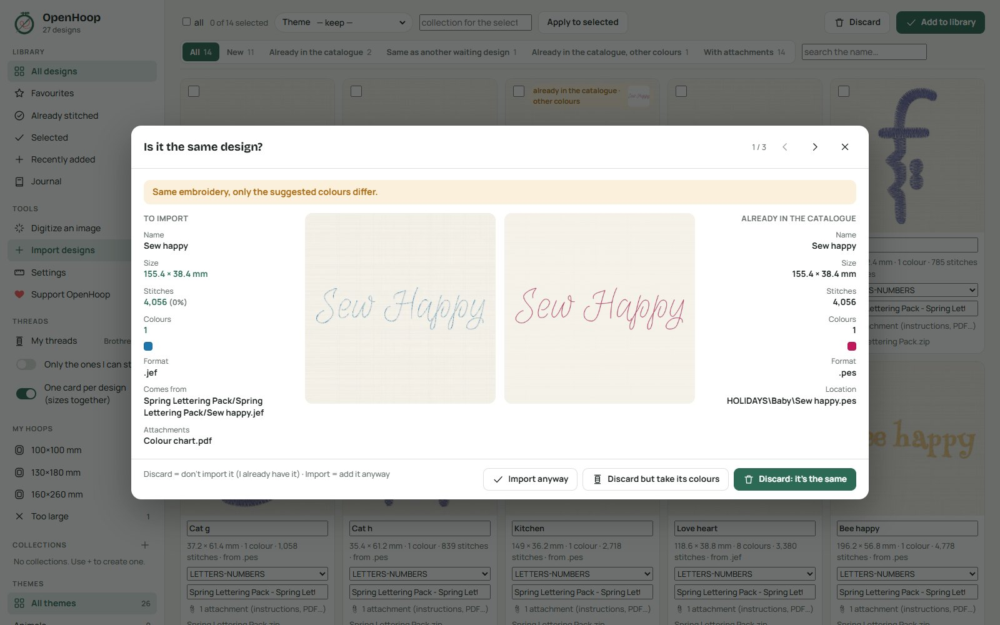 | 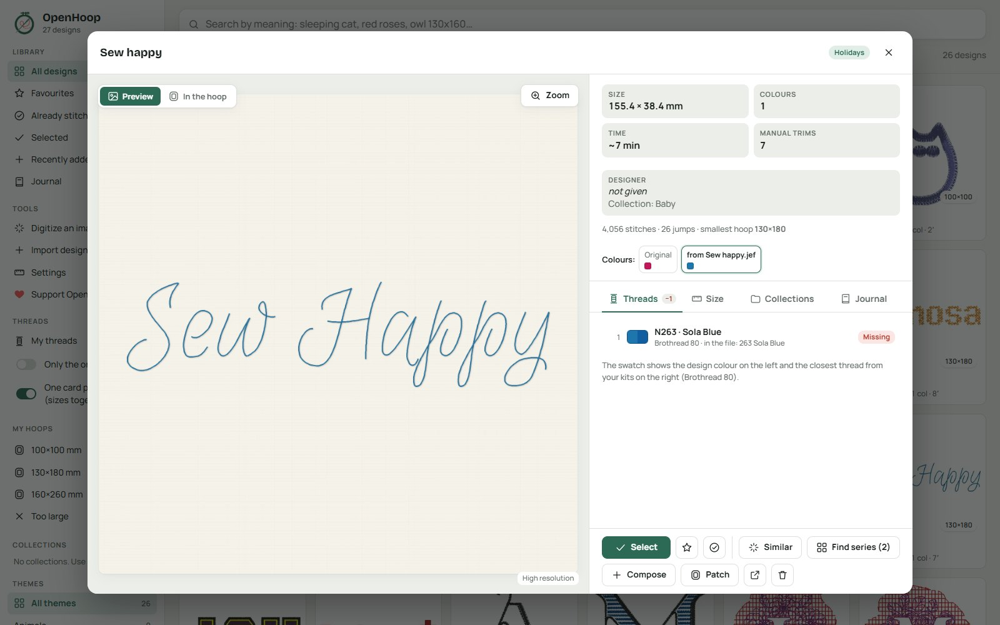 |
| **One-click updates** | |
| 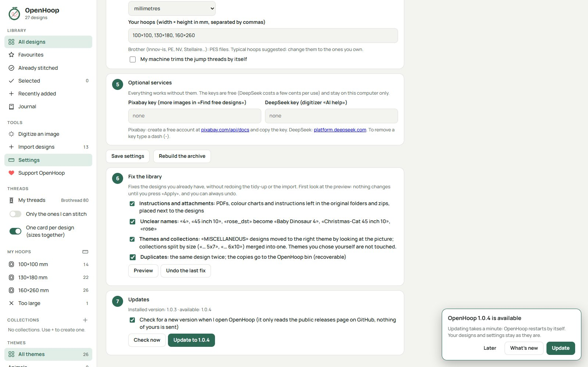 | |

Designs in the new screenshots are lettering made with OpenHoop's own embroidery fonts.

## Install (Windows 10/11)

1. Download **`OpenHoop-<version>.zip`** (e.g. `OpenHoop-1.0.1.zip`) from the [latest release](../../releases/latest) and unzip it where you like,
   e.g. `C:\OpenHoop`.
2. Double-click **`OpenHoop.exe`**. The first time it offers to install what it needs: Python if missing, the
   libraries, the lettering fonts and the AI model for search by meaning (about **8 GB** of disk in total,
   15–40 minutes depending on your connection). Windows may say «Windows protected your PC» because the program is
   new and not signed: click **More info → Run anyway**.
3. From then on start OpenHoop from the **desktop icon**. The first time it asks for your language, your design
   folders and your machine, then builds the tidy archive.

An NVIDIA graphics card makes the first analysis much faster, but it is not required.

OpenHoop opens in your browser and puts an icon next to the clock: right-click it → **Quit** to close the program.
If something goes wrong, the log is in `%APPDATA%\OpenHoop\openhoop.log`; `installa.bat` repairs or completes the
installation.

## Optional services

Under **Settings → Optional services** you can add your own free keys:
[Pixabay](https://pixabay.com/api/docs/) (more images in «Find free designs») and
[DeepSeek](https://platform.deepseek.com/) (AI help in the digitizer, a few cents per use).
OpenHoop works fully without them.

## Please note

- Designs you buy or download keep their own licence: OpenHoop only organizes them.
- The «characters» search finds cartoon and video game characters: they are protected by copyright,
  **use them for personal projects only, never for things you sell**.
- OpenHoop is a hobby project: test new or resized designs on a scrap of fabric first.

## Support

OpenHoop is free and always will be. If it saves you time, you can
[buy me a coffee on Ko-fi](https://ko-fi.com/openhoop) ☕ — thank you!

## License

[GNU GPL v3](LICENSE). Third-party components and their licences: [CREDITS.md](CREDITS.md).

---

## Italiano

**Perché OpenHoop?** Negli anni ho accumulato **centinaia di migliaia di file da ricamo**: raccolte, omaggi, acquisti,
lo stesso disegno in cinque formati e tre misure, zip dentro zip. Ritrovare «quel gatto in 130×180» voleva dire una
serata di ricerche, e i programmi che potevano aiutare costano tanto e sono pensati per i professionisti. Così ho
costruito lo strumento che volevo per la mia macchina e lo regalo: chi ricama per hobby merita strumenti buoni senza
pagare centinaia di euro di licenza. OpenHoop è fatto da un appassionato di ricamo **con l'aiuto di strumenti di
programmazione con l'intelligenza artificiale**; è gratuito, open source e provato ricamando davvero.

**OpenHoop** è un programma gratuito e open source per chi ricama a macchina: riordina i file da ricamo (un solo file
per disegno, niente doppioni, divisi per tema con le miniature), li trova per nome, misura o significato, mostra
tempo, colori e tagli a mano, ed esporta nel formato della tua macchina direttamente sulla chiavetta.
Puoi provare altri colori direttamente sul disegno: passi il mouse, la parte si illumina e con un clic ne cambi il filo.
Ci sono anche il creatore di toppe (scudo, cerchio, ovale, cuore… su feltro o tutte ricamate, salvate accanto al
disegno d'origine), scritte con 140 font da ricamo, un digitalizzatore per immagini semplici e la ricerca di disegni
gratuiti. I file originali non vengono mai spostati né modificati e tutto resta sul tuo computer.

> **🧪 Progetto agli inizi: cerchiamo chi lo provi!** Finora OpenHoop è stato provato ricamando solo con **una
> macchina Brother (file PES)**. Janome, Bernina, Husqvarna Viking, Pfaff, Singer e le altre sono supportate sulla
> carta, ma nessuno le ha ancora provate. Se ne hai una, raccontaci com'è andata aprendo una
> [segnalazione](../../issues): se i file si aprono, il telaio, i colori, la qualità dei punti e le toppe. Le foto sono benvenute.
> Fai sempre prima una prova su un ritaglio di stoffa.

**Installazione:** scarica **`OpenHoop-<versione>.zip`** (es. `OpenHoop-1.0.1.zip`) dall'[ultima versione](../../releases/latest), scompattalo e fai doppio clic su
**`OpenHoop.exe`**: la prima volta installa quello che serve (se Windows avvisa «PC protetto», scegli **Ulteriori
informazioni → Esegui comunque**), poi si apre dall'icona sul desktop. Al primo avvio scegli lingua, cartelle dei
ricami e macchina. Per chiuderlo: clic destro sull'icona vicino all'orologio → **Esci**.
Dalla versione 1.0.1 OpenHoop avvisa quando c'è una versione nuova e **si aggiorna con un clic** (Impostazioni →
Aggiornamenti), senza toccare i tuoi disegni e le impostazioni.

Se OpenHoop ti è utile puoi [offrirmi un caffè su Ko-fi](https://ko-fi.com/openhoop) ☕.
